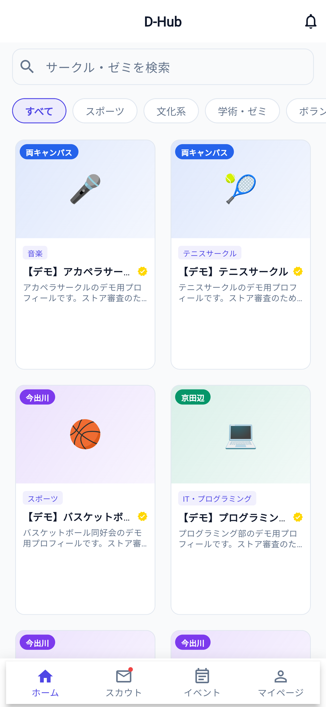
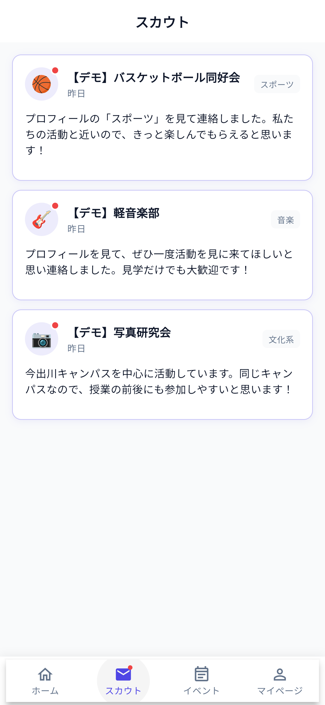
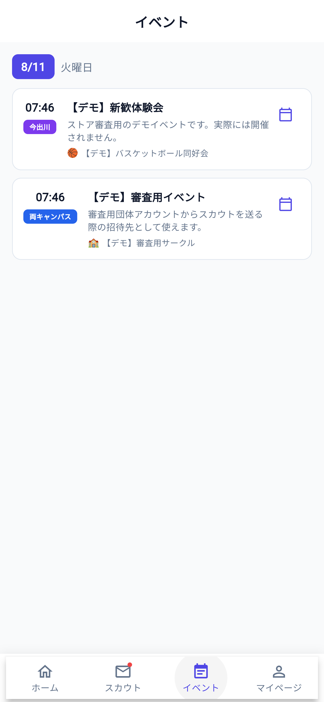
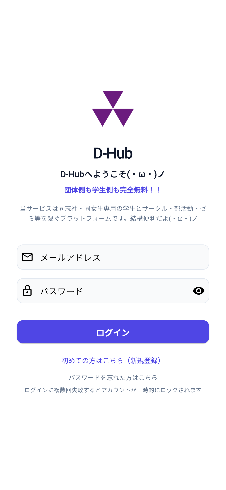
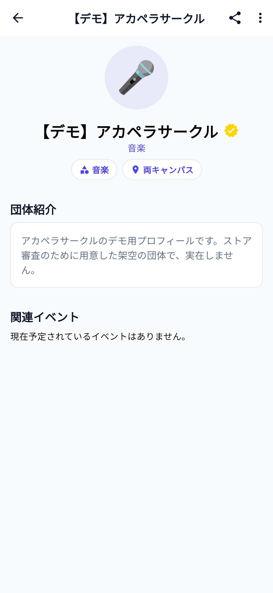
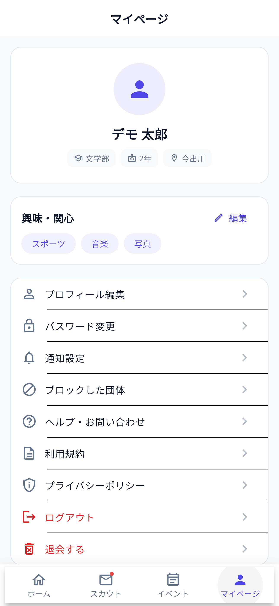
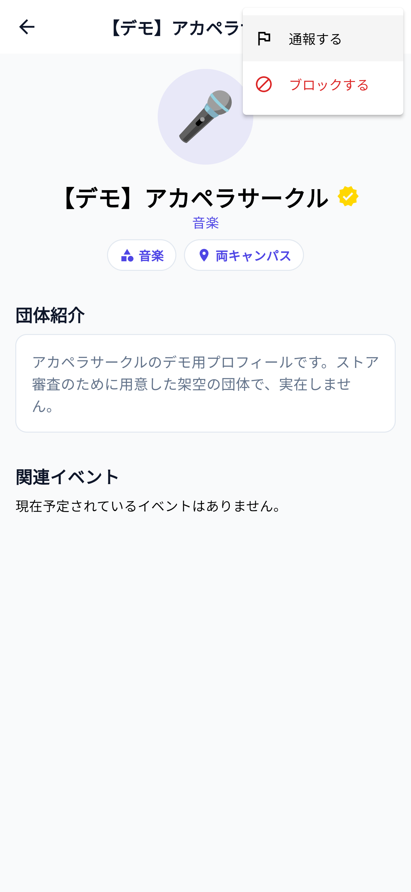

# D-Hub（ディーハブ）

[](https://github.com/nishikawataishi/D-Hub/actions/workflows/ci.yml)
[](https://flutter.dev/)
[](https://firebase.google.com/)

**同志社大学・同志社女子大学の学生と学内団体（サークル・ゼミ）をつなぐ、スカウト型マッチングプラットフォーム。**

学生が団体を探すのではなく、**団体から学生へ声がかかる**逆求人型のアプローチを採用しています。新歓の場に飛び込みにくい新入生にも、団体側から「ウェルカム」を届けられるようにすることが目的です。

- 🌐 Web アプリ: https://d-hub-link.com
- 📱 iOS アプリ: [App Store](https://apps.apple.com/jp/app/id6804482037)（D-Hub 同志社・同女生のためのアプリ）
- 📄 サービス紹介: https://www.d-hub-link.com

> 代表の西川大司が企画・要件定義・設計・技術選定・セキュリティ設計を担当し、実装には AI コーディングエージェント（Claude Code）を活用しています。2026年10月からは運営メンバー4名（PM・広報・団体パートナー）が加わっています。

---

## 画面イメージ

| ホーム（団体一覧） | スカウト受信 | イベント一覧 |
| :---: | :---: | :---: |
|  |  |  |

<details>
<summary>その他の画面を見る（ログイン / 団体詳細 / マイページ / モデレーション）</summary>

| ログイン | 団体詳細 | マイページ | 通報・ブロック |
| :---: | :---: | :---: | :---: |
|  |  |  |  |

</details>

---

## 目次

- [解決する課題](#解決する課題)
- [主な機能](#主な機能)
- [技術スタック](#技術スタック)
- [アーキテクチャ](#アーキテクチャ)
- [セキュリティ設計](#セキュリティ設計)
- [品質保証 / CI](#品質保証--ci)
- [セットアップ](#セットアップ)
- [プロジェクト構成](#プロジェクト構成)
- [ドキュメント](#ドキュメント)
- [ライセンス](#ライセンス)

---

## 解決する課題

| 立場 | 課題 | D-Hub のアプローチ |
| :--- | :--- | :--- |
| **学生** | 数多のサークル・ゼミから自分に合うものを探すのは負担が大きく、知らない場に飛び込むのも怖い | プロフィールを登録しておけば、団体側から興味に基づいたスカウトが届く |
| **団体** | 興味を持ちそうな学生に届く手段が、SNSとビラしかない | 学年・キャンパス・興味タグで学生を検索し、直接アプローチできる |
| **双方** | 学外の不審なアカウント、実体のない団体が混ざるリスク | 大学メールによる在籍確認と、運営による団体審査で閉じた空間を維持 |

---

## 主な機能

### 学生向け
- **2層認証** — アカウント登録（メール／パスワード）に加え、大学メールアドレスへの確認コードで在籍を確認
- **団体検索** — インクリメンタル検索とジャンルフィルタによる一覧表示
- **スカウト受信** — 団体からの勧誘を受け取り、興味があれば Instagram・LINE で直接つながる
- **イベント参加** — 学内イベントの閲覧・参加申請・カレンダー登録（キャンパス別のカラーラベル付き）
- **プロフィール管理** — 学部・学年・キャンパス・興味タグ・写真ギャラリー
- **ブロック / 通報** — 特定の団体からのスカウトを遮断、不適切な相手を運営に通報

### 団体向け
- **学生検索とスカウト送信** — 条件で学生を探し、**5種類の定型文**から選んで送信
- **イベント作成・参加者管理** — イベントの公開と、参加申請の承認／却下
- **団体プロフィール** — 活動内容、写真、Instagram・LINE への導線

### 運営向け
- **団体審査** — 申請された団体を承認／却下（承認されるまでスカウトもイベント作成もできない）
- **自動通知** — 新規の通報・団体申請が入ると運営宛にメールで通知
- **通報対応・ユーザー管理・問い合わせ管理**

---

## 技術スタック

| レイヤー | 技術 | 採用理由 |
| :--- | :--- | :--- |
| **フロントエンド** | Flutter 3.41.2 / Dart SDK ^3.11.0 | 1つのコードベースで Web・iOS・Android に対応。少人数で複数プラットフォームを扱うため |
| **状態管理** | provider 6.1 | 認証状態の管理が中心の構成に対して、ChangeNotifier + Consumer で必要十分 |
| **モデル層** | freezed 3.2 / json_serializable | イミュータブルなデータクラスと JSON 変換を自動生成し、ボイラープレートを排除 |
| **認証** | Firebase Authentication | メール／パスワード認証、Custom Claims による権限管理 |
| **データベース** | Cloud Firestore | リアルタイム同期、セキュリティルールによるサーバーサイド権限制御 |
| **サーバーレス** | Cloud Functions Gen2 (Node.js 22) | 確認コードの検証、退会・削除時の後片付け、運営通知など、クライアントに置けない処理 |
| **ストレージ** | Cloud Storage for Firebase | アイコン・団体写真・ギャラリー画像・団体の証明画像 |
| **メール送信** | Nodemailer | 確認コードと運営通知の配信 |
| **ホスティング** | Firebase Hosting | マルチサイト構成（アプリ本体 + 紹介ページ） |
| **DNS** | Cloudflare | カスタムドメイン管理 |
| **CI / リリース** | GitHub Actions / fastlane | 7ジョブの CI と、iOS の TestFlight 配信（後述） |

> 配信状況: **Web 版**（d-hub-link.com）と **iOS 版**（App Store）を公開しています。Android は CI 上でビルド検証のみ行っています。

---

## アーキテクチャ

```
                       Flutter (Web / iOS / Android)
                                    │
             ┌──────────────────────┼──────────────────────┐
             ▼                      ▼                      ▼
    Firebase Auth          Cloud Firestore          Cloud Storage
  ・メール/パスワード認証    ・セキュリティルール943行    ・ルール115行
  ・Custom Claims で権限    ・全コレクションで入力検証    ・画像のみ / 5MB未満
                                    ▲                      ▲
                                    │ Admin SDK            │
                             Cloud Functions Gen2 ─────────┘
                ・callable 6本: 確認コード送信/検証、退会、管理者権限の付与/剥奪 ほか
                ・トリガー 5本: 削除時の後片付け、通報・団体申請の運営通知
```

**Firestore のコレクション構成**

| コレクション | 役割 |
| :--- | :--- |
| `users` | 学生プロフィール（+ `private` に認証メタデータ、`blocks` にブロック情報） |
| `organizations` | 団体情報と審査ステータス（+ `blocks`） |
| `events` | イベント（+ `applications` サブコレクションで参加申請） |
| `scouts` | 団体から学生へのスカウト |
| `reports` | 通報 |
| `contacts` | 問い合わせ |
| `tags` | 興味タグのマスタ |
| `university_email_locks` | 1つの大学メールで複数アカウントが認証されるのを防ぐロック |
| `admin_notifications` ほか | 運営通知の重複防止・流量制限、退会処理の排他制御（サーバー専用） |

---

## セキュリティ設計

「学生限定のクローズドな空間」を成立させるため、**アプリ側の実装を信用しない**方針で設計しています。クライアントを改造されても成立する制約を、Firestore / Storage のセキュリティルールとサーバーサイド（Cloud Functions）に置いています。

### 1. 2層認証による在籍確認

Firebase Auth の標準認証だけでは任意のメールアドレスで登録できてしまうため、大学への在籍を確認する2層目を独自に実装しました。

1. **第1層** — メールアドレスとパスワードによるアカウント作成
2. **第2層** — 大学ドメイン（`mail*.doshisha.ac.jp` / `dwc.doshisha.ac.jp`）宛に6桁の確認コードを送信

第2層の処理はすべて Cloud Functions（サーバーサイド）で実行されます。

- 確認コードは **SHA-256 でハッシュ化して保存**（平文は保存しない）、照合は定数時間比較
- **送信回数の上限**（1時間あたり3回）、**試行回数の上限**（1コードにつき5回）、**有効期限**（30分）
- 送信回数の判定はトランザクション内で行い、**並列呼び出しで上限をすり抜ける経路を塞いでいます**
- 宛先アドレスは厳格な正規表現で検証し、複数宛先の相乗りによる迷惑メール送信を防止
- 送信時と検証時の両方で、Firebase Auth 上の最新メールアドレスとの一致を確認（コード受信後のメールすり替えを防止）
- 同じ大学メールでの重複認証はロックで防止し、退会時は自動で解除
- ログに出す大学メール（学籍番号を含む）はマスク

**第2層を終えていないアカウントは、団体一覧・イベント・画像の閲覧や、参加申請・通報などの操作をルール側で一律に拒否**しています。

### 2. 権限設計（3ロール）

学生 / 団体 / 運営の3ロールを定義し、運営権限は **Firebase Auth の Custom Claims** で判定しています（メールアドレスの文字列比較ではないため、クライアントからの偽装ができません）。

主な制約：

- **自己昇格の防止** — 学生認証の状態を保持するフィールドは、更新時だけでなく**作成時にも**持てないようにしてあります（ドキュメントを削除して作り直す経路を塞ぐため）
- **自己承認の防止** — 団体は作成時のステータスが「申請中」に固定され、自身で審査ステータスを書き換えることはできません
- **審査済み団体のみが行動可能** — スカウト送信・イベント作成は、運営が承認した団体に限定されます
- **個人情報の隔離** — 認証メタデータは `users/{uid}/private` に分離し、クライアントからは書き込み不可・団体からは参照不可
- **管理者権限の事故防止** — 権限付与時に既存の Claims を保持し、自分自身の管理者権限の剥奪は拒否

### 3. スカウトの定型文化（自由記述の排除）

スカウトの本文は**5種類の定型文**から選ぶ方式で、自由記述はできません。これを利用規約や運用ルールではなく、**セキュリティルール上の制約**として実装しています。

定型文に埋め込む値も検証対象で、たとえば「興味タグに共感しました」を送るには、そのタグが**対象の学生が実際に登録しているタグ**である必要があります。イベントへの招待も、**自団体が実際に公開している、まだ終わっていないイベント**でタイトルが一致していなければ保存できません。

さらに、スカウトに載る団体名・アイコン・Instagram・LINE の URL は**公開中の団体情報と一致することを強制**しており、宛名や絵文字欄に連絡先を紛れ込ませたり、別の LINE に誘導したりする抜け道を塞いでいます。ブロックされた団体からのスカウトは作成そのものが拒否されます。

### 4. 入力値の検証

全コレクションで、許可するキー・型・文字数の上限・列挙値をルールで検査しています。想定外の値で画面を落とす攻撃や、1ドキュメントに大量のデータを書き込む攻撃を防ぐためです。

- **URL の検証** — Instagram / LINE の URL は正規のホストのみ許可し、`instagram.com.evil.cc` のようなホスト偽装を遮断
- **画像 URL の範囲制限** — 保存できる画像 URL を本プロジェクトの Storage の、本人のフォルダ配下に限定（外部サイトへのアクセスログ収集や他人の画像の流用を防止）
- **ルールの評価上限への配慮** — Firestore ルールの式評価上限（1,000式）に収まるよう、正規表現と集合演算で検査をまとめています

### 5. 通報

通報内容は運営のみが参照でき、通報者が誰かは通報された相手に開示されません。自分自身への通報、規定外の通報理由、長文の投稿はルール側で弾かれます。新規の通報は運営宛にメールで通知されます。

### 6. ストレージ

画像ファイルのみ・5MB 未満・所有者のみ書き込み可という制約をルールで強制しています。審査前の団体の画像や団体の証明画像は第三者から見えず、ファイル一覧の取得（削除済みの過去画像の列挙）も禁止しています。

### 7. データの後片付け

退会や運営による削除の際は、Cloud Functions のトリガーが関連するイベント・参加申請・スカウト・ブロック情報・画像・認証アカウントをまとめて削除します。退会処理とトリガーが同時に走って二重に削除しないよう、排他制御を入れています。

### 8. コストの安全弁

Cloud Functions に同時実行数の上限（全体10・関数ごと5）を設け、運営通知メールにも流量制限（1時間5通・1日20通）をかけています。不正なアクセスが集中した場合でも、利用料金が青天井にならないようにするためです。

### 9. HTTP セキュリティヘッダー

`X-Content-Type-Options` / `X-Frame-Options` / `X-XSS-Protection` / `Referrer-Policy` / `Permissions-Policy` / `Strict-Transport-Security` を設定し、Content-Security-Policy は Flutter Web（CanvasKit）と Firebase の通信先に合わせて個別に定義しています。

### 10. 資格情報の管理

Firebase の設定ファイル・署名鍵は **Git 管理から除外**し、CI では GitHub Secrets から復元しています。SMTP の資格情報は Firebase Secrets Manager で管理し、コードから分離しています。

---

## 品質保証 / CI

`.github/workflows/ci.yml` — `main` / `feat/**` / `fix/**` への push と、すべての Pull Request で実行されます。作業は `feat/**` / `fix/**` ブランチで行い、CI がすべて通った PR のみ `main` にマージします。

```
push / PR
  ├─ test ──────────┬─ build-web       ← test が通らないとビルド系は走らない
  │                 ├─ build-android
  │                 └─ build-ios
  ├─ rules-test     ┐
  ├─ functions-lint │ 並列実行
  └─ security       ┘
```

| ジョブ | 内容 |
| :--- | :--- |
| `test` | `flutter analyze` による静的解析と `flutter test` |
| `rules-test` | エミュレータ上で Firestore（97件）/ Storage（22件）のセキュリティルールを **計119件**検証 |
| `functions-lint` | Cloud Functions を ESLint で検査（管理者権限で動くコードのため） |
| `security` | 秘密ファイルの混入検査と `npm audit` |
| `build-web` | 本番配信物のビルドと成果物の保存 |
| `build-android` | APK / AAB のビルド（署名は Secrets から復元） |
| `build-ios` | macOS ランナーでのビルド検証（ビルド番号を自動採番） |

このほか、Cloud Functions を Auth / Firestore / Storage のエミュレータと組み合わせて動かす**統合テスト（16件）**を `firestore-tests/functions.test.mjs` に用意しています（手動実行）。

**設計上の意図**

- **セキュリティルールもテストする** — ルールは1,000行を超える実行されるコードであり、変更のたびに壊れうるため、人力レビューではなく自動テストで守っています。攻撃パターンだけでなく、**すでに本番にある古い形式のデータで正規の操作が止まらないか**も検証しています。Firestore と Storage はルールファイルも評価も別なので、必ず両方を起動して検証します。
- **秘密ファイルの混入検査を自前で持つ** — GitHub の secret scanning は「認証情報らしい文字列」しか検知しないため、設定ファイルや署名鍵の追跡状態を直接検査するステップを追加しています。
- **依存関係はロックファイル厳守** — `npm install` ではなく `npm ci` を使い、ロックファイルを更新しない限り依存の中身が変わらないようにしています。
- **止める基準を使い分ける** — 即時対応が必要な深刻度のみ CI を失敗させ、それ以外は毎回サマリに出力して可視化しています。常に赤い CI は誰も見なくなるためです。

### 依存関係の監視（Dependabot）

`functions` / Flutter 本体 / ルールテスト / GitHub Actions 自体の**4つ**を監視対象にしています。

公開直後のバージョンには飛びつかないよう **cooldown**（パッチ7日 / マイナー14日 / メジャー30日）を設定しています。近年の npm サプライチェーン攻撃では、侵害されたバージョンが公開されていた期間が数時間から1日程度だったため、更新を待つだけで大半を回避できるという判断です。GitHub Actions 自体を対象に含めているのは、Actions が侵害された場合に CI の Secrets が漏れうるためです。

### iOS リリース

`.github/workflows/release-ios.yml` — fastlane で iOS ビルドを TestFlight にアップロードします。外部への操作でビルド番号を消費するため、**push では起動せず手動実行のみ**、同時実行も禁止しています。既定では証明書と Secrets の検証だけを行うプリフライトモードで動きます。手順は [`docs/store/03_ios_release_runbook.md`](docs/store/03_ios_release_runbook.md) にまとめています。

---

## セットアップ

### 前提

- Flutter SDK 3.41.2（CI と同一）
- Node.js 22
- Firebase CLI / FlutterFire CLI

### 手順

```bash
git clone https://github.com/nishikawataishi/D-Hub.git
cd D-Hub
flutter pub get
```

Firebase の設定ファイルは Git 管理から除外しているため、自分の Firebase プロジェクトに接続して生成してください。

```bash
firebase login
flutterfire configure    # lib/firebase_options.dart が生成される
```

```bash
flutter run -d chrome
```

### セキュリティルールのテスト

```bash
cd firestore-tests
npm ci
firebase emulators:exec --only firestore,storage --project demo-rules-test \
  "node --test rules.test.mjs storage.rules.test.mjs"
```

### Cloud Functions の統合テスト

```bash
cd firestore-tests
firebase emulators:exec --only auth,firestore,functions,storage --project <your-project-id> \
  "node --test functions.test.mjs"
```

### デプロイ

```bash
flutter build web --release       # ← 必ずビルドしてから
firebase deploy --only hosting
firebase deploy --only functions
firebase deploy --only firestore:rules,storage
```

---

## プロジェクト構成

```
lib/
  ├── models/       データモデル（Freezed / json_serializable）
  ├── screens/      画面（23ファイル）
  │   └── components/  共通コンポーネント
  ├── services/     Firestore / Auth / Storage / 画像処理
  └── theme/        デザイントークン
functions/          Cloud Functions（callable 6本 + トリガー 5本）
firestore-tests/    ルールテスト（119件）と Functions 統合テスト（16件）
firestore.rules     Firestore セキュリティルール
storage.rules       Storage セキュリティルール
ios/fastlane/       TestFlight 配信の設定
docs/
  ├── pm/           プロジェクト憲章・ステークホルダー登録簿・計画書
  ├── spec/         要件定義・基本設計・詳細設計・テスト計画
  └── store/        App Store 掲載情報・リリース手順書
lp/                 サービス紹介ページ
```

---

## ドキュメント

設計や運用に関するドキュメントは [`docs/`](docs/) 配下にまとめています。

| カテゴリ | ドキュメント | 内容 |
| :--- | :--- | :--- |
| **設計書** | [`docs/spec/01_requirements_definition.md`](docs/spec/01_requirements_definition.md) | 要件定義書 |
| | [`docs/spec/02_basic_design.md`](docs/spec/02_basic_design.md) | 基本設計書 |
| | [`docs/spec/03_detailed_design.md`](docs/spec/03_detailed_design.md) | 詳細設計書 |
| | [`docs/spec/04_test_plan.md`](docs/spec/04_test_plan.md) | テスト計画書 |
| **プロジェクト管理** | [`docs/pm/01_project_charter.md`](docs/pm/01_project_charter.md) | プロジェクト憲章 |
| | [`docs/pm/02_stakeholder_register.md`](docs/pm/02_stakeholder_register.md) | ステークホルダー登録簿 |
| | [`docs/pm/03_project_management_plan.md`](docs/pm/03_project_management_plan.md) | プロジェクトマネジメント計画書 |
| **ストア公開** | [`docs/store/01_app_store_listing.md`](docs/store/01_app_store_listing.md) | App Store 掲載情報 |
| | [`docs/store/02_screenshot_guide.md`](docs/store/02_screenshot_guide.md) | スクリーンショット撮影手順 |
| | [`docs/store/03_ios_release_runbook.md`](docs/store/03_ios_release_runbook.md) | iOS リリース手順書 |

---

## ライセンス

本リポジトリにはライセンスを設定していません。著作権は作者に帰属し、無断での利用・複製・再配布はできません。
